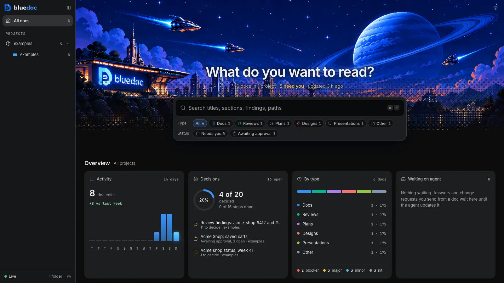
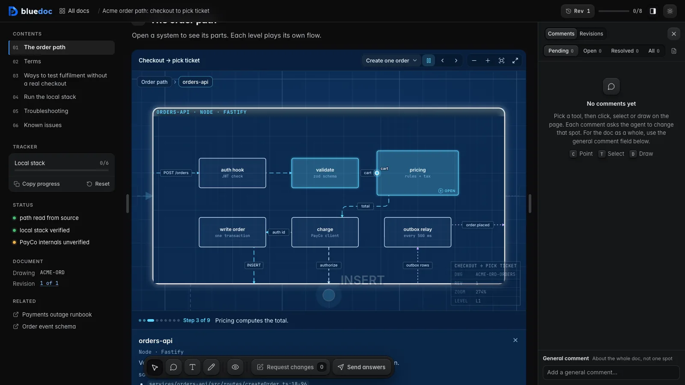
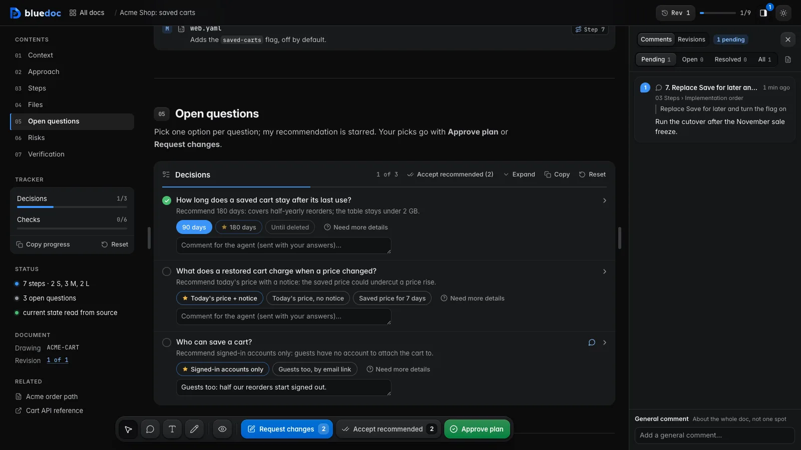
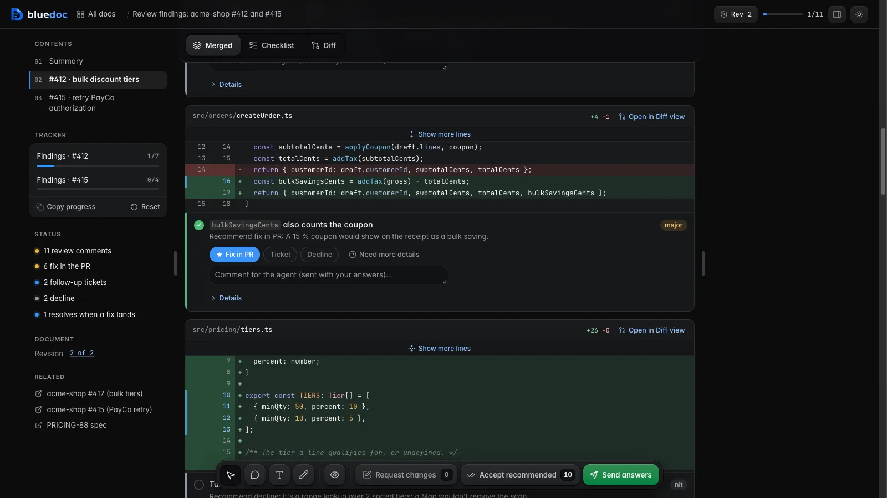
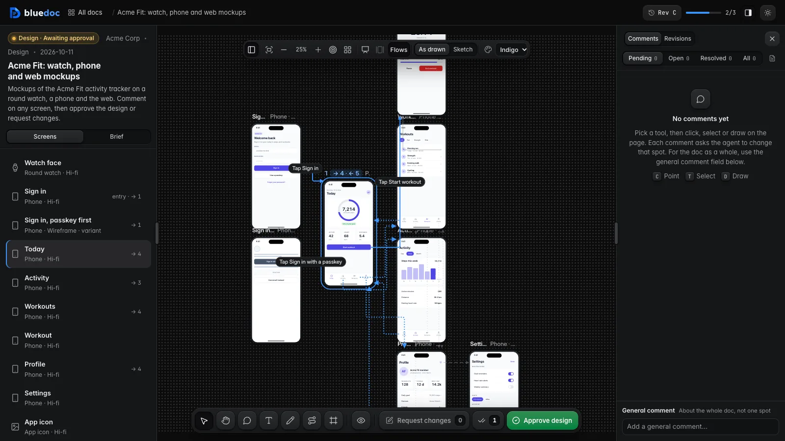
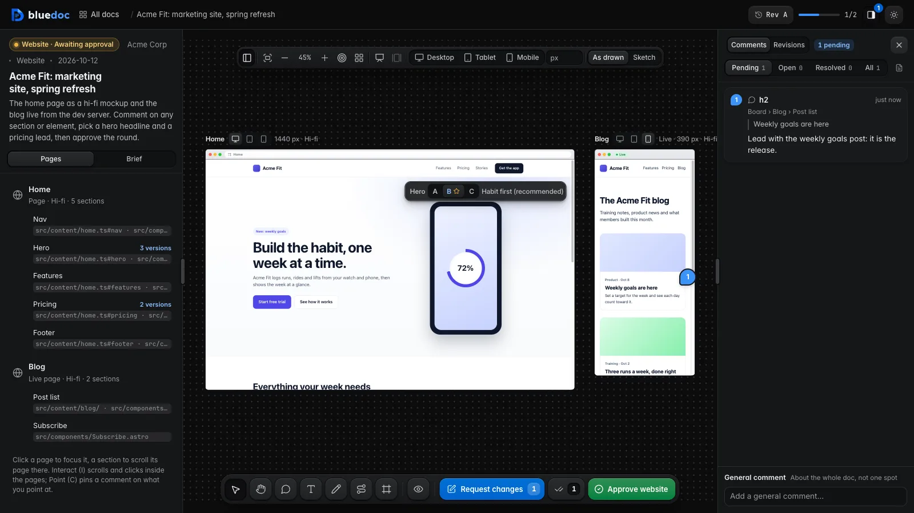
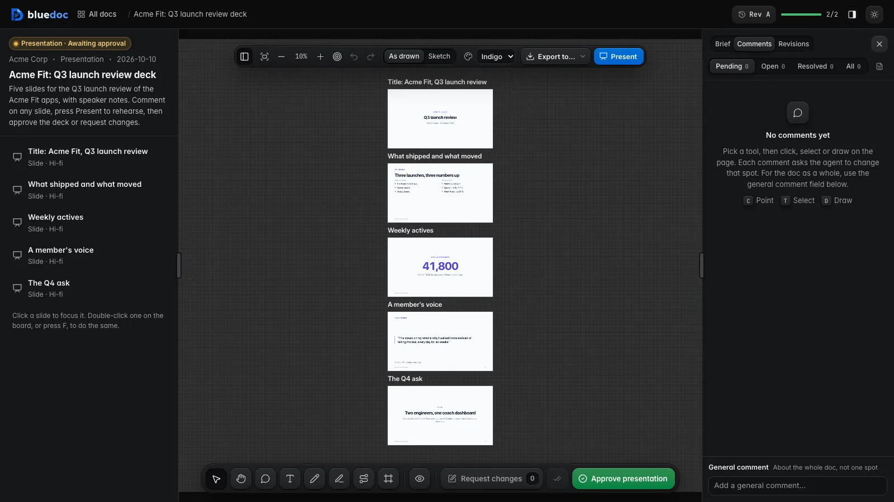
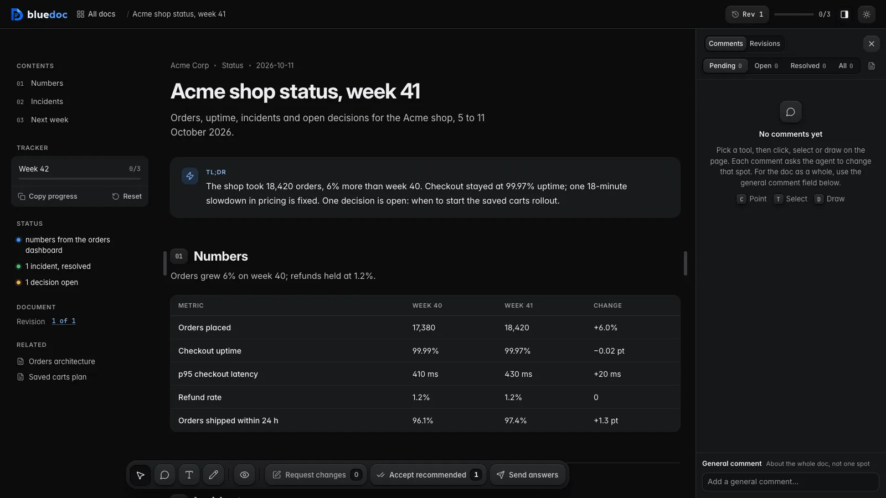

# bluedoc



An agent skill for engineering docs, plans, code reviews, UI designs, slide decks, website reviews and app icons. The agent writes one JSON file, plus small HTML fragments for screens and SVG layers for icons; a local server renders it as a page. You tick checklists, pick options, comment on any element and approve or send back; your answers and change requests go to the agent, and each revision can be compared with the last. Works with Claude Code, Codex, pi and omp.

> **Beta.** bluedoc is in beta: the doc format and commands may still change between betas. It is tested on macOS; Linux and Windows are untested. Issues and feedback are welcome on GitHub.

This is bluedoc's source repo (`andreiverdes/bluedoc-src`): code, docs, examples and tests. Releases are published to [andreiverdes/bluedoc](https://github.com/andreiverdes/bluedoc), a minimal repo with only what agents install; the install commands below use it.

## Doc types

| Type | What it's for | Page | |
|---|---|---|---|
| `docs` | Architecture pages, walkthroughs, runbooks, setup guides, change proposals | [docs](docs/types/docs.md) | [](docs/types/docs.md) |
| `plan` | A plan you approve or send back before the agent writes code | [plan](docs/types/plan.md) | [](docs/types/plan.md) |
| `review` | Review findings pinned to their lines from git, one decision per finding | [review](docs/types/review.md) | [](docs/types/review.md) |
| `design` | UI screens on a board and app icons | [design](docs/types/design.md) | [](docs/types/design.md) |
| `website` | A site's pages, live from its dev server: comment on sections, pick versions in place, each comment names the source to edit | [website](docs/types/website.md) | [](docs/types/website.md) |
| `presentation` | Slide decks with speaker notes, played in Present | [presentation](docs/types/presentation.md) | [](docs/types/presentation.md) |
| `other` | Status pages, incident reports, inventories, meeting notes, comparisons | [other](docs/types/other.md) | [](docs/types/other.md) |

## What you get

- **A home page.** `http://127.0.0.1:8740/` lists every doc the server knows. It opens on a pixel-art banner of a bay with a ringed planet, a night version for the dark theme and a day version for the light one, with the title and search field over it. Under the search field, chips filter by doc type and status, with a count on each; a sidebar lists projects with their folder trees. Each doc is a card whose hero shows its type's own element (a review's +/− lines, a plan's step timeline, a doc's drawing), in a grid (2–6 columns), a list or a board.
- **Blueprint canvas.** Open a system to see its parts; each level plays its own animated flow (request, event, data). Nests 3 levels deep. Edges are routed at right angles around the nodes, with labels that don't overlap.
- **Checklists as task trackers.** Each item is a two-line row (the action, then why it matters) that opens to show details, commands, checks, tables or a sub-checklist. Ticks persist on the local server; **Copy progress** exports Markdown for a PR or issue.
- **Decisions.** When the agent needs you to choose, an item shows its options as pills with the agent's recommendation starred. Pick one, or press **Accept recommended** to take every starred option at once.
- **Need more details.** Every decision item has a **Need more details** toggle after its pills. It leaves the pick alone, turns the item's dot amber and asks what is missing; the agent answers in the next revision with a fuller description and options. A plan, design, presentation or website can't be approved while an item asks for more details. Turning the toggle off withdraws a sent request.
- **Comments and Revisions tabs.** The right panel of every doc has two tabs. Comments lists your notes as Pending (saved), Open (sent) or Resolved, with a General comment field for the whole doc. Revisions switches to any earlier revision or compares two: new, changed and removed parts are marked in place with a word-level diff, next to the author's note on what changed.
- **Comments on anything.** A tray of keys at the bottom (View, Point, Select, Draw) pins a comment on an element, a selected passage or a drawn mark. **Request changes** sends the pending comments to the agent as edits to make; **Send answers** sends your picks, ticks and item comments.
- **The agent resolves what it addressed.** Each comment in a reply carries an id. The agent lists the ids it addressed in the new revision (`build.py patch … --resolves <id>`); on load, those comments move to Resolved with "Resolved by the agent in rev X".
- **Plans you approve on the page.** The goal, the proposed design on a canvas, before/after panes, mockups, a numbered timeline of steps, the files each step touches, open questions, risks and checks. **Approve plan** or **Request changes**; the agent waits for approval before it writes code.
- **Code review.** A `diff` block shows a change with each finding as a comment on its lines and its options on the card. The doc stores only the git range (`gitdiff.py` writes it); the server expands it from git on each render, falling back to `gh pr diff`. GitHub review threads come in through `ghthreads.py`.
- **Designs on a board.** Screens for a watch, phone, tablet, desktop window or browser, side by side on a pan-and-zoom board, at sketch, wireframe or hi-fi fidelity. Comment on a button, draw a box to ask for a new screen, compare a screen with an earlier revision, then **Approve design**.
- **Design navigation and editing.** A tappable element names the screen it opens. The board draws each link as a connector routed around the screens, and **Present** follows the taps. Drag a link's end to another screen, draw a new link, move screens or press **Tidy up**: each edit is a draft that goes to the agent with Request changes, as a `build.py patch` command that writes it into the doc.
- **App icons.** `--icons` adds an icon artboard of SVG layers. The board shows the iOS light, dark and tinted icons, Android's masks and themed icon, the store icons and four home screens. **Export** writes every PNG with `Contents.json` and the adaptive-icon XML.
- **Presentations.** `build.py new presentation` scaffolds a deck of 16:9 slides with speaker notes. **Present** plays them full-window: ← → to step, `N` for notes, Esc to leave. Then **Approve presentation** or **Request changes**.
- **Websites.** `build.py new website --url http://localhost:4321/` puts a site's pages on a board, live from its dev server through a local proxy, hot reload included. Switch every page between desktop, tablet and mobile widths, pick between versions of a section in place, and point at anything: each comment carries its section's source file and the width you saw it at. Then **Approve website**.
- **HeroUI and Tailwind ship with the skill.** A screen uses the plain kit, HorizonUI, HeroUI with Tailwind, Tailwind alone or your project's own CSS, all offline.
- **Your input stays on your machine.** Ticks, picks, comments and replies live in `~/.bluedoc/state.db`, a SQLite file the server owns, never in the repo. Only a browser that opened a link from `serve.py open` or `serve.py unlock` can save. Design screens run sandboxed, with no network; a website's live pages load only from its dev server on this machine.
- **JSON only.** `serve.py` renders each doc from its JSON on every request; agents never write the page HTML. `build.py -o` writes a standalone HTML file when you need to send one.
- **Readable pages.** Light and dark theme, adjustable text width, clean print, keyboard and screen-reader outline. The build flags filler, vague words, long sentences and checklist items that don't start with a verb.

Built examples to open in a browser: [`acme-orders.html`](docs/examples/acme-orders.html) (architecture and runbook), [`acme-review-findings.html`](docs/examples/acme-review-findings.html) (review findings for two PRs), [`acme-saved-carts-plan.html`](docs/examples/acme-saved-carts-plan.html) (a plan to approve), [`acme-status.html`](docs/examples/acme-status.html) (a weekly status page) and [`acme-site.html`](docs/examples/acme-site.html) (a website board; its live page needs the server). Download the file, then open it; GitHub shows HTML as source. Their JSON sources sit in `skills/bluedoc/examples/`, with the design board (`acme-fit-design.bluedoc.json`) and the deck (`acme-fit-deck.bluedoc.json`). `serve.py open <json>` opens any of them.

## Install

Pick your agent. Each one installs the same skill from this repository.

### Claude Code

```sh
claude plugin marketplace add andreiverdes/bluedoc
claude plugin install bluedoc@bluedoc
```

Inside a session the same commands are `/plugin marketplace add andreiverdes/bluedoc` and `/plugin install bluedoc@bluedoc`. Start a new session to load the skill.

### Codex

```sh
codex plugin marketplace add andreiverdes/bluedoc
codex plugin add bluedoc@bluedoc
```

Restart Codex. The skill is listed as `bluedoc:bluedoc`; mention it with `$bluedoc` or let Codex pick it from your request.

### pi

```sh
pi install git:github.com/andreiverdes/bluedoc
```

Restart pi. Run it as `/skill:bluedoc` or let pi pick it from your request.

### omp

```sh
omp plugin marketplace add andreiverdes/bluedoc
omp plugin install bluedoc@bluedoc
```

Run `/reload-plugins` in an open session, or start a new one.

### Any other agent

With the [skills CLI](https://skills.sh):

```sh
npx skills add andreiverdes/bluedoc
```

Or copy the skill folder by hand. Codex, pi and omp read `~/.agents/skills`; Claude Code reads `~/.claude/skills`.

```sh
git clone https://github.com/andreiverdes/bluedoc.git
ln -s "$PWD/bluedoc/skills/bluedoc" ~/.agents/skills/bluedoc
```

### Requirements

- Python 3.9 or later on `PATH` (the build and diff scripts use the standard library only).
- `git`, for code reviews.
- `gh`, signed in, only for importing GitHub review threads or diffing a PR whose repo isn't checked out.

## Use

Ask in plain words. The skill triggers on requests for HTML docs, architecture pages, walkthroughs, runbooks, status pages, plans, browsable reviews, UI mockups, slide decks, website reviews and app icons.

- "Write a bluedoc of how a request flows through this service."
- "Make a runbook for setting up the local stack, as a bluedoc with checklists."
- "Review PR 412 and give me a bluedoc where each finding sits on its code."
- "Put the open review threads on PR 412 in a bluedoc so I can decide what to do with each."
- "Plan saved carts as a bluedoc and wait for my approval."
- "Mock up the sign-in screen for the phone and the web as a bluedoc design."
- "Make a five-slide launch review deck as a bluedoc presentation."
- "Open our marketing site as a bluedoc website so I can comment on it."
- "Design the app icon for iOS and Android in the bluedoc design."

The agent scaffolds `docs/<topic>/<name>.bluedoc.json` from the type's skeleton (the only file it edits, plus any images the doc shows and a design's screen files; the revision history `<name>.bluedoc.history.json` and a review's diff cache `<name>.diffcache.json` sit next to it), fills it in, validates it and opens it on the local server:

```sh
python3 <skill>/scripts/build.py new plan docs/plans/saved-carts.bluedoc.json --title "Saved carts"   # skeleton with <<…>> to fill
python3 <skill>/scripts/build.py docs/plans/saved-carts.bluedoc.json        # validate, record the revision
python3 <skill>/scripts/serve.py open docs/plans/saved-carts.bluedoc.json   # start the server, print the URL (with a key good for an hour)
```

When you send comments back, the agent revises one object at a time, and the revision bumps itself:

```sh
python3 <skill>/scripts/build.py patch docs/plans/saved-carts.bluedoc.json item:decisions/retention \
  --set recommend=d90 --change "Retention: recommend 90 days, as asked."
```

Every doc the server knows is listed at `http://127.0.0.1:8740/`. When another program already holds port 8740, the server takes the next free port up to 8759, and the links `serve.py open` prints carry it; set `BLUEDOC_PORT` to pin a port of your own. Edit the JSON and reload; there is no build output to keep in sync. For a file you can send to someone, add `-o <name>.html` to the build command.

Per doc, the agent reads about 1.5k tokens of instructions (`SKILL.md`) plus one type guide (`types/<type>.md`), and greps the schema only for the fields it needs.

`<skill>` is the installed skill folder, for example `~/.agents/skills/bluedoc`.

## Design mockups

A design doc is a brief and one board of screens. Each screen is an HTML fragment in `<name>.design/<artboard id>.html` beside the JSON; the server wraps it in the chosen kit (plain, HorizonUI, HeroUI with Tailwind, Tailwind or your own CSS) and runs it sandboxed. Screens link to each other with `data-nav`, and `--icons` adds an app-icon sheet with PNG export. A presentation is the same page with a board of slides only; a website, with a board of web pages, live from the dev server or mocked up as screens.

Frameworks, navigation, board editing, app icons and the sandbox are covered in [docs/types/design.md](docs/types/design.md); decks in [docs/types/presentation.md](docs/types/presentation.md); live sites in [docs/types/website.md](docs/types/website.md).

## Update and remove

| Agent | Update | Remove |
|---|---|---|
| Claude Code | `claude plugin marketplace update bluedoc` then `claude plugin update bluedoc@bluedoc` | `claude plugin uninstall bluedoc@bluedoc` |
| Codex | `codex plugin marketplace upgrade bluedoc` | `codex plugin remove bluedoc@bluedoc` |
| pi | `pi update` | `pi remove git:github.com/andreiverdes/bluedoc` |
| omp | `omp plugin upgrade bluedoc@bluedoc` | `omp plugin uninstall bluedoc@bluedoc` |
| skills CLI | `npx skills update` | `npx skills remove bluedoc` |

## What's in the repo

```text
skills/bluedoc/
  SKILL.md               the workflow card the agent reads first
  types/<type>.md        one guide per doc type: plan, review, docs, design, presentation, website, other
  references/schema.md   every JSON field and command, for lookup
  references/kits.md     the plain kit's classes, HorizonUI in a screen, bringing your own framework
  assets/skeletons/      fill-in skeleton per doc type (build.py new), plus review-area.json (--shape area)
  scripts/build.py       new, validate, lint, patch, build the HTML
  scripts/gitdiff.py     git range + findings -> diff block (a git reference)
  scripts/diffref.py     expands diff references from the cache, git or gh
  scripts/migrate.py     one-off: embedded diffs -> references, reports contract gaps; --decks: slide-only designs -> presentations
  scripts/ghthreads.py   GitHub review threads -> findings + diff comments
  scripts/serve.py       local server: renders docs and design screens, proxies a website's dev server, home page, answers and change requests
  scripts/statedb.py     the reader's input and replies in ~/.bluedoc/state.db (SQLite)
  assets/template.html   the page runtime (styling, canvas, checklists, diff browser, design board, annotator)
  assets/board-geo.js    board layout and orthogonal edge routing, shared by design boards and blueprint canvases
  assets/home.html       the home page (HorizonUI)
  assets/kits/           what a design screen is wrapped in: shell, plain kit CSS, wireframe CSS, inspector (also injected into live website pages)
  assets/kits/icon-sheet.*  the app-icon sheet: every iOS and Android tile, drawn from the icon's layers
  assets/vendor/         files the pages load from the local server, never the network:
    horizon-ui/          HorizonUI browser build (Apache-2.0, see its NOTICE)
    heroui/              HeroUI's CSS and Tailwind's browser build, for design screens
    hero/                the home page's pixel-art banners, dark and light
    fonts/               the sketch hand font and Lexend's licence (Lexend-OFL.txt), both OFL-1.1
  examples/              Acme examples (JSON, history, diff cache, the review's git bundle)
  examples/*.design/     the design, deck and website examples' screen files
  examples/media/        images the examples show (media blocks)
docs/types/              one page per doc type, for GitHub readers
docs/media/              the screenshots those pages and this README show
docs/examples/           the examples built to HTML, for GitHub readers
tests/                   the test suite (python3 -m unittest discover -s tests)
.claude-plugin/          Claude Code plugin and marketplace (omp reads it too)
.agents/plugins/         Codex marketplace
plugin.json              Agent Plugins manifest (Codex, omp)
package.json             pi package manifest
release/                 release.sh and the release repo's README (plugin-README.md)
```

The examples describe Acme Corp, a fictional company.

## Release

Releases are made by hand, locally, into `andreiverdes/bluedoc`:

1. Bump the version in `package.json`, `plugin.json`, `.claude-plugin/plugin.json` and `.claude-plugin/marketplace.json` (twice): `1.0.0-beta02`, `1.0.0-beta03`, and so on.
2. Run the tests (`python3 -m unittest discover -s tests`, with `BLUEDOC_BROWSER_TESTS=1` for the browser tests) and commit.
3. Run `release/release.sh`. It copies HEAD's skill (without `examples/`), the manifests, `LICENSE` and `release/plugin-README.md` into a checkout of the release repo (`../bluedoc-release` by default), commits and tags `v<version>`, and prints the push command.

## License

bluedoc's own code: MIT (`LICENSE`). The vendored HorizonUI build under `skills/bluedoc/assets/vendor/horizon-ui/` is Apache-2.0 (its `LICENSE` and `NOTICE`), and the Inter and JetBrains Mono fonts it ships are OFL-1.1 (its `THIRD_PARTY_NOTICES.md`). Under `skills/bluedoc/assets/vendor/heroui/`, Tailwind's browser build (`@tailwindcss/browser` 4.3.3) is MIT, and HeroUI's CSS (`@heroui/styles` 3.2.6) declares MIT in its `package.json` while its `LICENSE` file is the Apache-2.0 text; both licence files sit in `licenses/` there, unchanged. The Architects Daughter hand font under `skills/bluedoc/assets/vendor/fonts/` is OFL-1.1 (its licence file sits beside it). The bluedoc wordmark is "bluedoc" set in Lexend Bold and outlined to paths in `home.html` and `template.html`; Lexend is OFL-1.1 (`vendor/fonts/Lexend-OFL.txt`). The manifests declare `MIT AND Apache-2.0 AND OFL-1.1`, which covers both readings.
