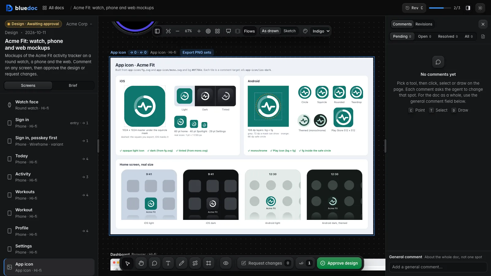

# Design

UI mockups on a pan-and-zoom board: one HTML screen per artboard, in a device frame, that you comment on and approve. Slide decks are their own type: [presentation](presentation.md); so is a website you review live from its dev server: [website](website.md).


## Features

- **Device frames.** Each artboard is a round or square watch, a phone, a tablet, a desktop window, a browser, a 16:9 slide, an app icon sheet, or a free size. Screens sit side by side on a board you pan and zoom.
- **Screens are HTML.** Each screen is a small HTML body fragment the agent writes in `<name>.design/<artboard id>.html`. The server wraps it in a kit, so the agent never writes `<head>`, framework links or tokens.
- **Frameworks.** Built in, offline: the plain kit (tokens, layout, type, buttons, fields, wireframe boxes, a hand font for sketches), HorizonUI, HeroUI (`heroui`: HeroUI's CSS with Tailwind's browser build) and Tailwind alone (`tailwind`). Your project's own CSS and JS: name the files in `board.frameworks[].files`, relative to the doc. A framework your project doesn't have: `serve.py add-framework daisyui` fetches a pinned preset, and `serve.py add-framework <name> <path|url>` copies your own files; either lands once in `~/.bluedoc/frameworks/<name>/` with a manifest of sizes and sha256, and boards name it with `store`. It is the only network fetch, and only on your command. When a framework's files are missing, its screens fall back to the plain kit with a notice, and the build warns. A doc that names the old `heroui` or `tailwind` store loads the shipped copy.
- **When the project has none,** the agent recommends HeroUI for web, desktop and mobile screens, and the plain kit for watches and slides. HeroUI runs as its CSS classes plus Tailwind utilities compiled inside the frame; Konsta UI, the usual mobile kit, ships only framework components that a static screen can't load.
- **Fidelity and Sketch.** Each artboard is `sketch`, `wireframe` or `hifi`. **Sketch** in the board toolbar redraws every screen hand-drawn (wobbly lines, hand font); **As drawn** shows each at its own fidelity.
- **Theme re-skin.** The brief lists themes as sets of tokens. Pick one in the brief or the toolbar and every screen re-skins at once.
- **Links between screens.** A tappable element names its target: `data-nav="workout"` (push, the default), `modal:settings`, `tab:activity`, `replace:today` or `back`, with an optional `data-nav-label="Tap Start workout"`. A gesture has nothing to tap, so it is a hidden named element: `<i hidden data-bd="swipe-left" data-nav="tab:activity" data-nav-label="Swipe left"></i>`. `board.entry` names the first screens. The build reads the links, lints them (a target that isn't an artboard, a link element without a `data-bd` name, a screen no entry reaches) and records them with each revision.
- **Orthogonal connectors and reach.** The board draws each link as a faint right-angle connector, routed around screens, from the element to its target. **Flows** shows every link; otherwise the selected screen's links show. Select or hover a screen to brighten its arrows in and out and count them (`→ 4 · ← 5`).
- **Present click-through.** **Present** plays the screens full-window and follows the taps, with a back stack and each link kind's transition.
- **Editing arrows as drafts.** Point on an arrow to comment on it (`link:today/tab-workouts`). In Link mode (`L`) drag an arrow's end onto another screen, change its kind or label, delete it or draw a new one. Each edit is a draft in your reader state; the board and Present follow it at once, and it goes to the agent with **Request changes**.
- **Moving screens and Tidy up.** Drag a screen, Shift-click to move several, snap to the others' edges, nudge with the arrow keys. With `layout: "flow"` the board places screens without `x`, `y` in columns by depth from the entry; **Tidy up** arranges the whole board once in layers with no overlaps and no crossings. Moves and Tidy up are drafts too, kept across reloads in `~/.bluedoc/state.db`; Request changes sends them as one `layout:main` item with the `build.py patch <doc> layout:main --json '{…}'` command that writes the positions into the doc.
- **Edit mode.** Press **Edit** (`E`) in the tray, click an element in a screen to select it (an orange outline with its name), double-click its text to change it in place, or press Delete to remove it. Text is plain text; Enter or a click away keeps it, Esc puts it back. Each change is a draft: the screen shows it at once and after a reload, the Comments panel lists it with **Discard**, or **Restore** for a deletion, and Request changes sends it with a `build.py patch <doc> el:<screen>/<element> --set 'text="…"'` or `--delete` command that rewrites that one element in the screen file.
- **Undo and redo.** ⌘Z undoes and ⇧⌘Z redoes (Ctrl+Z, Ctrl+Shift+Z or Ctrl+Y elsewhere) every board draft: text edits, deletions, Restore and Discard, link edits, moves and Tidy up, one step per action, also from inside a screen. The **Undo** and **Redo** keys beside the drafts count name the step in their tooltip. The history is kept per doc across reloads, up to 200 steps, starts over on each new revision, and stops at what Request changes already sent. In a text field the browser's own undo runs.
- **App icons with PNG export.** `build.py new design … --target mobile --icons` adds an `app-icon` artboard of SVG layers in `<name>.design/app-icon/`: `fg.svg`, `mono.svg` and a background colour (`icon.bg`) or `bg.svg`, on a 108-unit square. The board shows them as one sheet: the iOS light, dark and tinted icons, Android's masks, themed icon and safe circle, the store icons and four home screens. The build lints the layers (no `fg.svg`, scripts or network URLs, the mark outside the safe circle, `<text>`). **Export PNG sets** renders every PNG with `Contents.json` and the adaptive-icon XML, and saves them to `<name>.icons/app-icon/`, or downloads a zip from a `-o` file.

  

- **Comments on a screen.** Point at an element to comment on it: the key is `el:<artboard>/<name>`, from the element's `data-bd` name, so the agent edits that element in that file. `artboard:<id>` keys a whole screen; a box drawn in Frame mode asks for a new screen (`frame:`). Notes collect in the **Comments** tab; a comment the agent lists in a revision's `resolves` turns Resolved.
- **Revisions and compare.** Each build records the screens' HTML, links and icon layers in the doc's history file, stored once per version. An edit to a screen file counts as an edit to the doc: it voids an approval, as a JSON edit does. The **Revisions** tab compares a screen with an earlier revision **side by side** or as an **onion skin** (the newer one over the older, with an opacity slider); compare marks links New, Removed or Changed.
- **Request changes or Approve design.** As on plans, the agent waits for **Approve design** on the current revision; your picks in the brief go with it.
- **The board.** The toolbar stays centred over the board. The left panel lists the screens; the right one holds **Brief** (the TL;DR, the brief's sections and picks, status), **Comments** and **Revisions**. Drag a panel's inner edge to resize it; every design page in that browser remembers the widths. Double-click a handle to reset.
- **Sandbox.** Each screen runs in an `<iframe sandbox="allow-scripts">` from its own route, whose CSP allows no network connections. A screen can't read the page, your cookies or stored input, post an approval, or navigate the tab. The build rejects network URLs, `<base>`, `<meta http-equiv>`, `<iframe>`, `<object>`, `<embed>` and `<form action>` in screen files.

## How an agent makes one

```sh
python3 <skill>/scripts/build.py new design docs/design/sign-in.bluedoc.json --title "Sign in" --target mobile,web [--icons]
python3 <skill>/scripts/build.py docs/design/sign-in.bluedoc.json         # validate, lint the screens, record the revision
python3 <skill>/scripts/serve.py open docs/design/sign-in.bluedoc.json    # the board
python3 <skill>/scripts/serve.py wait docs/design/sign-in.bluedoc.json --kind any
```

`--target` takes `watch`, `mobile`, `tablet`, `desktop` and `web`; a deck is `build.py new presentation` ([presentation](presentation.md)). The agent writes each screen file, then answers comments with `build.py patch <doc> el:<artboard>/<name> --change "…" --resolves <comment id>`.

## Examples and guide

- Board with flows: [`acme-fit-design.bluedoc.json`](../../skills/bluedoc/examples/acme-fit-design.bluedoc.json), the Acme Fit activity tracker on a round watch, eight linked phone screens, an app icon and a web dashboard, over three revisions. Screens in [`acme-fit-design.design/`](../../skills/bluedoc/examples/acme-fit-design.design/).
- Open it with `python3 <skill>/scripts/serve.py open skills/bluedoc/examples/acme-fit-design.bluedoc.json`.
- Agent guide: [`skills/bluedoc/types/design.md`](../../skills/bluedoc/types/design.md). Kit classes: [`skills/bluedoc/references/kits.md`](../../skills/bluedoc/references/kits.md).
