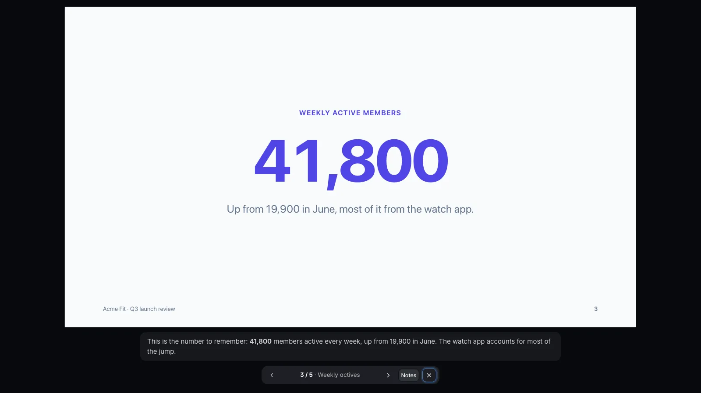

# Presentation

Slide decks on a board: one HTML slide per artboard, 16:9, with speaker notes, that you rehearse in **Present**, comment on and approve.


## Features

- **Slides are HTML.** Each slide is a 1920×1080 `slide` artboard, a small HTML body fragment the agent writes in `<name>.design/<slide id>.html` with the plain kit's slide classes: kicker, title, body, columns, a big number, a quote, a footer with the page number. The server wraps it in the kit, so the agent never writes `<head>`, framework links or tokens.
- **One column in deck order.** The board stacks the slides top to bottom in the order the doc lists them, the order **Present** plays them.
- **Present.** The toolbar's primary key. It plays the slides full-window, each as large as the window allows: ← → to step, `N` for the speaker notes under the slide, Esc to leave.

  

- **Speaker notes.** Each slide's `notes` (Markdown, up to 2 KB) show under it in Present, never on the slide.
- **Export HTML.** The download key beside Present, and in Present's bar, saves the deck you're viewing as one `.html` file that plays anywhere, offline: arrows, Space or a click to step, `N` for notes, `F` for full screen. Agents run `build.py <doc> --deck out.html`.
- **Slides only.** A presentation's board holds `slide` artboards and nothing else; the build fails on a phone or any other device and points to a design doc for screens. A design may still hold an occasional slide.
- **Theme re-skin and Sketch.** The brief's theme pick re-skins every slide at once; **Sketch** redraws the deck hand-drawn for a rough first pass.
- **Comments on a slide.** Point at an element to comment on it: the key is `el:<slide>/<name>`, from the element's `data-bd` name, so the agent edits that element in that file. `artboard:<id>` keys a whole slide. Notes collect in the **Comments** tab; a comment the agent lists in a revision's `resolves` turns Resolved.
- **Revisions and compare.** Each build records the slides' HTML in the doc's history file. The **Revisions** tab compares a slide with an earlier revision side by side or as an onion skin.
- **Request changes or Approve presentation.** As on plans and designs, the agent waits for **Approve presentation** on the current revision; an edit to any slide file asks for approval again. On the home page presentations have their own type, count toward **Awaiting approval** and **Approved**, and their card draws the deck's slides.
- **Sandbox.** Each slide runs in an `<iframe sandbox="allow-scripts">` with no network, as design screens do.

## How an agent makes one

```sh
python3 <skill>/scripts/build.py new presentation docs/decks/q3-review.bluedoc.json --title "Acme Fit: Q3 launch review"
python3 <skill>/scripts/build.py docs/decks/q3-review.bluedoc.json         # validate, lint the slides, record the revision
python3 <skill>/scripts/serve.py open docs/decks/q3-review.bluedoc.json    # the deck
python3 <skill>/scripts/serve.py wait docs/decks/q3-review.bluedoc.json --kind any
```

`new presentation` writes the brief and three wireframe slides (`title`, `content`, `closing`). The agent fills them in, adds slides, then answers comments with `build.py patch <doc> el:<slide>/<name> --change "…" --resolves <comment id>`.

A deck made before this type, a `design` doc whose board holds only slides, keeps working as a design. `python3 <skill>/scripts/migrate.py <docs-folder> --decks` makes such docs presentations; build each one afterwards.

## Example and guide

- Example: [`acme-fit-deck.bluedoc.json`](../../skills/bluedoc/examples/acme-fit-deck.bluedoc.json), a five-slide Q3 launch review of the Acme Fit apps with speaker notes. Slides in [`acme-fit-deck.design/`](../../skills/bluedoc/examples/acme-fit-deck.design/). Open it with `python3 <skill>/scripts/serve.py open skills/bluedoc/examples/acme-fit-deck.bluedoc.json`.
- Agent guide: [`skills/bluedoc/types/presentation.md`](../../skills/bluedoc/types/presentation.md). Slide classes: `## Slides` in [`skills/bluedoc/references/kits.md`](../../skills/bluedoc/references/kits.md).
